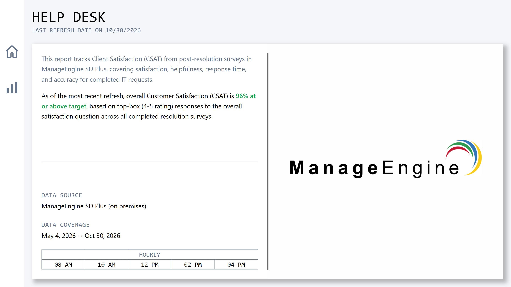
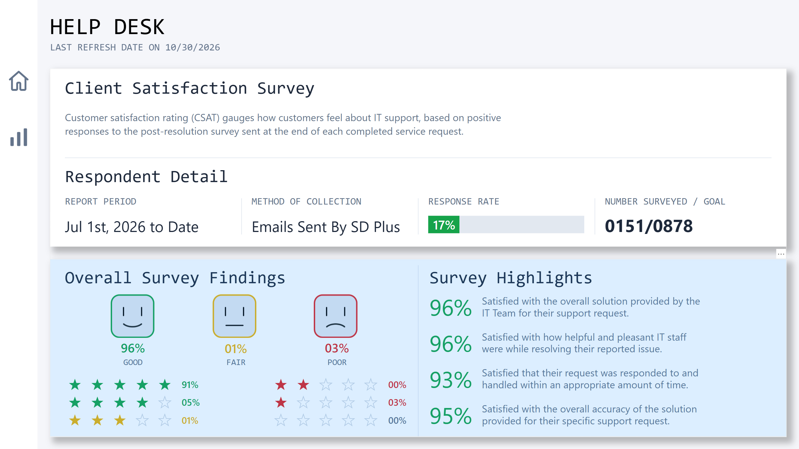
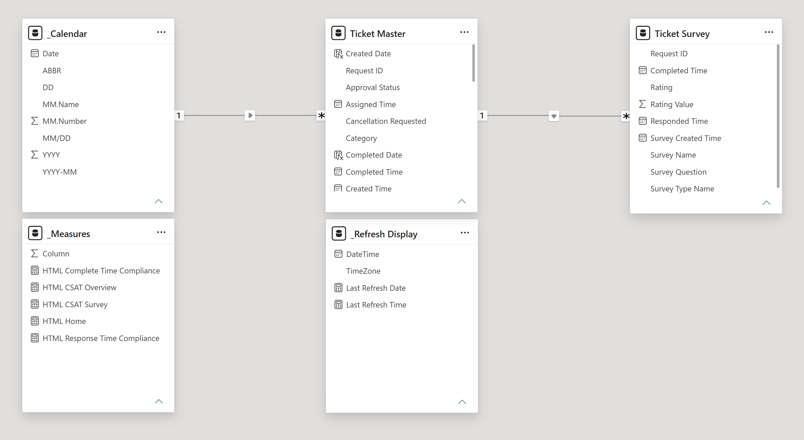

# Help Desk CSAT Dashboard

A customer satisfaction report for IT support, built on post-resolution survey responses from ManageEngine ServiceDesk Plus. It shows how people feel about the help they received, from the overall rating down to specific areas like staff helpfulness, response time, and accuracy of the solution.

## What it shows

- Overall satisfaction, split into good, fair, and poor ratings
- Survey response rate and progress toward the response goal
- Satisfaction with solution, helpfulness, response time, and accuracy

**Data source:** ManageEngine ServiceDesk Plus (on-premises SQL Server)
**Built with:** Power BI, DAX, SQL Server, Canva

Built on my [Power BI Report Template](https://github.com/franklinbusi/report-template).
